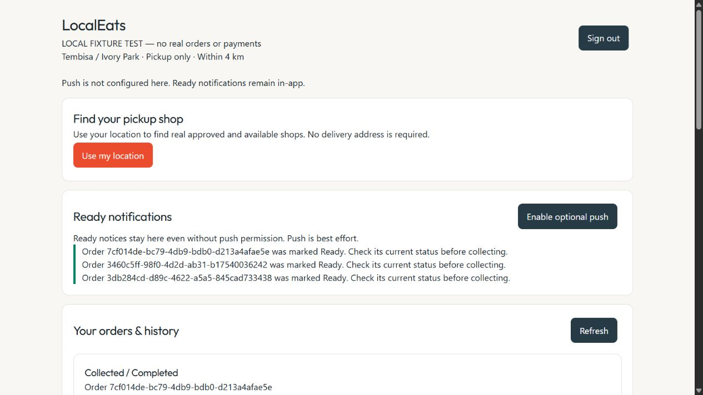
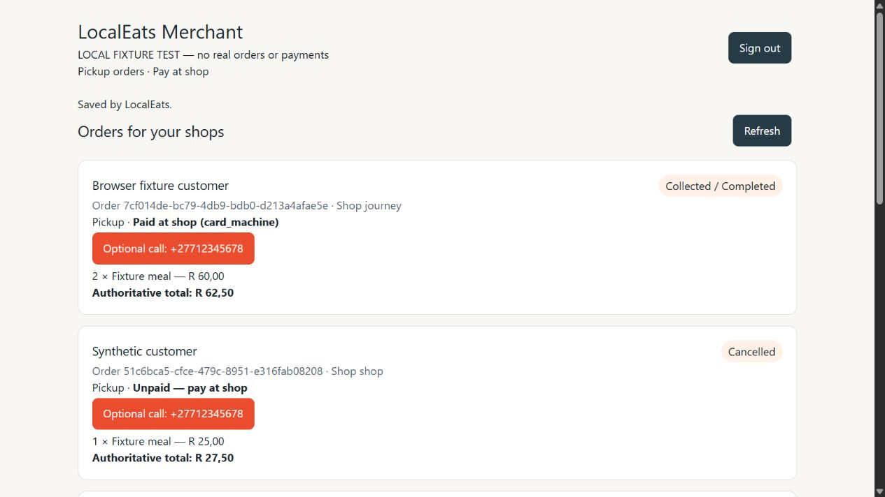

# Pickup journey: local implementation and testing

Implemented and tested locally; NOT approved for production rollout. No push, merge, deploy, production SQL/data access, or provider/hosting/billing/environment change.

## Baselines and commits

Merchant/API started at 2796f2d94f4fb5f00b37d5cf087721d7a31f294d on launch/pickup-only-pilot-01. Its 20 preserved uncommitted foundation files passed review, 122 tests and disposable PostgreSQL, then were committed first as feat: implement pickup order API foundation (fff79be; full SHA in git log). The next local commit contains merchant UI, town/radius discovery and integration tests.

Customer started clean at 7ff0a3fb1288aab769928785a311b53272deda72 on launch/pickup-only-pilot-01. Its local commit adds the customer pilot, API adapter, safe worker and tests. Final commit SHAs are returned in the handoff. Original documentation checkouts, patches, evidence directories and unrelated repositories were untouched.

## Active features

Both main entry points import focused src/pickup apps. Legacy screens remain in source/history, but do not mount delivery/dispatch, fake catalog/GPS, Firestore order writes, offline mutation replay, fabricated success, POS/manual direct writes or unrelated unfinished features beside pickup. Merchant Rider source and all migration history remain unchanged. The pilot bootstrap also omits the old direct-Firestore error logger and automatic cache-clearing recovery; the focused error boundary offers reload while retaining retry identifiers. Legacy profile/settings/menu administration surfaces are not mounted by these pilot entries.

Merchant: API-owned-shop orders, actual contact/phone, items/quantities, authoritative total, pickup type, canonical status and independent payment. Accept enters Preparing; pending orders can be rejected; Preparing becomes Ready with durable customer event. Explicit cash/card-machine payment confirmation marks only Paid. Separate actual-handover confirmation marks Collected. Optional phone link; no online-paid label or Rider request. UID-scoped sessionStorage retains unresolved command ID/revision/payload for safe replay, never order authority.

Customer: Firebase sign-in, real geolocation, real API catalog/menu, one-shop quantities, name/callable phone, cash or physical-card-at-shop intent. No card credentials, delivery address, Rider, delivery fee or tip controls. A server quote shows exact lines/service fee/total and requires consent. Only API-confirmed persistence becomes order success. Lost-response recovery retains the identical creation body/key in UID-scoped sessionStorage across reload. History, tracking and Ready inbox poll/refresh from the API. Server cancellation/rejection facts distinguish outcomes. Payment and Collected remain separate.

New GET /api/v1/catalog/pickup-shops?lat=...&lng=... checks approved/unarchived active shops, valid persisted GPS, and maximum 4 km straight-line distance. Town eligibility uses existing authoritative location text naming Tembisa/Thembisa/Ivory Park. Quote and locked SQL creation enforce the same metadata rule. Missing metadata fails closed. No invented boundary polygon, scattered GPS or historical backfill.

## Ready and optional FCM

Ready audit events also supply the durable authorized inbox. They remain after collection and say to check current status. No second notification table or paid provider.

FCM uses existing SDK/Admin dependencies and existing VITE_FIREBASE_VAPID_KEY when configured. Data-only generic Ready pushes use event-ID notification tags; a click opens current authoritative state. The customer worker precaches static shell only, never API authority or queued business mutations.

Permission is requested only from the optional push button. Unsupported, denied or unconfigured push leaves the inbox available. Registration binds token to authenticated UID/installation through the API. Sign-out attempts API revocation and SDK token deletion; remote revocation can fail during network outages and is not guaranteed. Server delivery uses existing scoped, leased, bounded attempts. No paid queue, scheduler or permanent worker. Live FCM device delivery was not tested: credentials/settings were untouched. Fixture mode disables real FCM.

## Validation results

- API: 124 passing tests, including retained Phase 1 behavior and new town/coordinate guards; build and TypeScript no-emit pass.
- Each shipped frontend adapter: four tests covering Firebase bearer/no-store, missing auth, bad/error responses, unconfirmed order IDs and identical lost-response retry.
- Both frontend builds pass, including generated workers.
- Customer full TypeScript (npm run lint) passes.
- Merchant pickup-scoped TypeScript and ESLint pass.
- Merchant full TypeScript has 62 errors in retained legacy source. An archived copy of the pre-UI HEAD, with the same installed dependencies, produces the exact same normalized diagnostics. No pickup-surface diagnostic.
- Merchant full ESLint reports 79 errors and 14 warnings in retained legacy files. New pickup-scoped ESLint is clean. Unrelated repairs were not bundled.
- PostgreSQL 17.11: actual draft execution, grants/RLS, append-only facts, deferred rollback, independent payment/handover, scoped replay, push fencing and true concurrent create/accept-cancel sessions pass.
- Both actual shipped client adapters run through real Express HTTP into real local PostgreSQL transactions. Identity verification is a synthetic test boundary; this is not live Firebase or PostgREST verification.
- Browser: customer fixture sign-in, approved fixture shop/menu, quantity two, R62.50 server quote and consent, durable order, merchant sees actual phone/items/total, Preparing, Ready/in-app notice, explicit card payment while still Ready, separate handover/Collected, customer reload retains history and notice. Optional push honestly unavailable.
- HTTP/database tests also cover a response lost AFTER commit, same-order recovery, duplicate Ready, cancellation/rejection, cross-customer/shop denial, expired identity, unavailable menu, database failures and no pickup Rider assignment.
- Final diff/secret inspection and clean local commit status are returned in the handoff. No real shop/customer order, payment or provider notification was created by testing.

Synthetic browser evidence:

## Repeatable commands

Keep the current sibling layout: work/merchant-api-pickup and work/customer-pickup. Node 24 and existing PostgreSQL 17.11 were used.

1. In each frontend root, install locked dependencies if missing: npm ci --ignore-scripts --no-audit --no-fund
2. In merchant-api-pickup/localeats-api: npm ci --ignore-scripts --no-audit --no-fund, then npm test
3. In that API directory: ./tests/pickup/validate.ps1 -Journey
4. In each frontend root: npm run test:pickup, then npm run build
5. Customer full type check: npm run lint
6. Merchant scoped type check: ./node_modules/.bin/tsc.cmd --noEmit -p tsconfig.pickup.json
7. Merchant scoped lint: ./node_modules/.bin/eslint.cmd src/pickup

The runner accepts -PostgresBin and -Port; default binaries are C:/Program Files/PostgreSQL/17/bin and the database port is 55432. It creates a unique ignored node_modules/.cache/pickup-pg-* cluster, explicitly connects host and hostaddr to 127.0.0.1, uses synthetic roles/data and stops that exact cluster in finally. It never changes installed database services, Supabase, active/archived migration history or environment values. Stopped evidence remains locally. This is representative schema testing, not full production-schema fidelity.

## Interactive browser testing

Start three terminals:

1. API directory: npm run build, then ./tests/pickup/validate.ps1 -Serve
2. Customer root: ./node_modules/.bin/vite.cmd --host 127.0.0.1 --port 5173 --strictPort
3. Merchant root: ./node_modules/.bin/vite.cmd --host 127.0.0.1 --port 5174 --strictPort

Open http://127.0.0.1:5173/?fixture=1 and http://127.0.0.1:5174/?fixture=1.
Customer fixture: customer@example.test
Merchant fixture: merchant@example.test
Both synthetic passwords: fixture-pass-only

These are NOT real Firebase accounts. Select Use my location in fixture mode to read the harness's synthetic location; choose Journey fixture kitchen. Other visible orders are SQL test fixtures.

Fixture mode requires DEV + loopback + explicit fixture=1, visibly labels operation, forces local API proxy regardless of an otherwise configured API URL, connects minimal loopback mock identity on 9099 and suppresses real FCM. It cannot be enabled through a query string in production builds. The development proxy targets only 127.0.0.1:4000. Never enter real credentials/data in this harness.

Stop the fixture using Invoke-WebRequest -Uri http://127.0.0.1:4000/__pickup_fixture/stop -Method Post, or interrupt its terminal. Stop both Vite terminals afterward. The completed agent run stopped its own servers and clusters.

## Remaining unapproved dependencies

1. SQL remains in supabase/drafts; no active migration or remote application. Review actual schema/policies/other triggers, service-role privileges and RPC exposure through PostgREST before an approved coordinated API/schema/client cutover.
2. Verify both frontend Firebase projects and API Admin verification/FCM credentials align. Existing per-repository project configs may differ. This task did not alter settings, credentials or environment values; fixture identity is not production-identity proof.
3. Owner must verify real approved shop town labels, GPS, menu availability and physical-card support. Missing metadata is intentionally rejected. The rule is not a surveyed municipal polygon or proof of physical presence.
4. Verify the built worker, secure origin and existing permitted VAPID/FCM configuration on an approved staging device. In-app Ready already works independently; live push delivery remains unverified.
5. Confirm no-new-cost commercial hosting eligibility/quotas. The actual plan is unverified. Vercel Hobby's non-commercial restriction does not approve this commercial pilot. No host switch or upgrade was made.
6. Retained legacy type/lint debt must be addressed before reintroducing those surfaces. Older clients/workers must be included in rollout review; the API/database remain the authority.
7. No push, merge or deploy is authorized. Main may auto-deploy, so do not casually push these commits. Rollback must retain orders, payment/collection projections and immutable audit events; use a compatible API or read-only mode rather than restoring unsafe writes.

The bounded pickup journey is implemented and tested locally. This is readiness for further local/approved staging testing, NOT a production GO.
